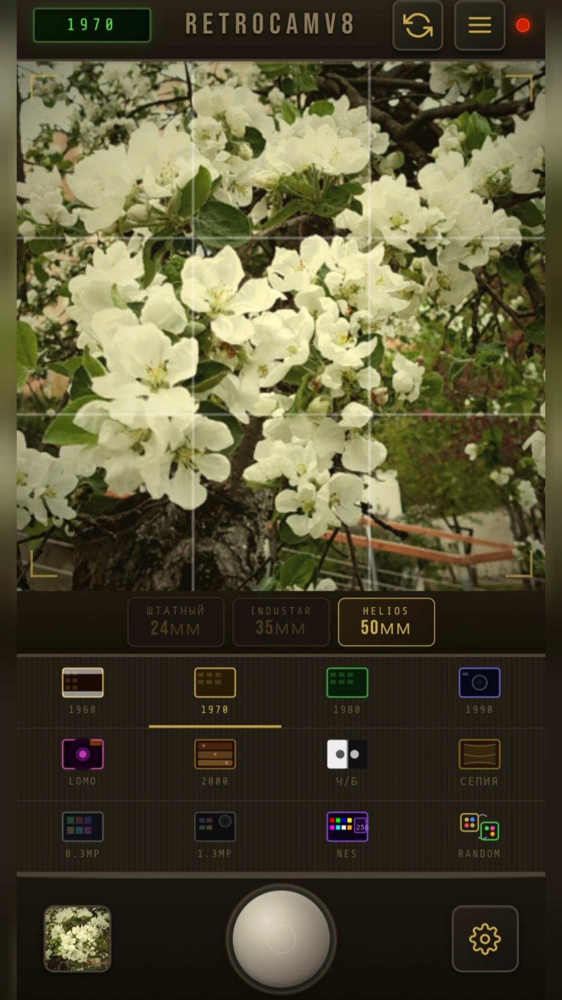
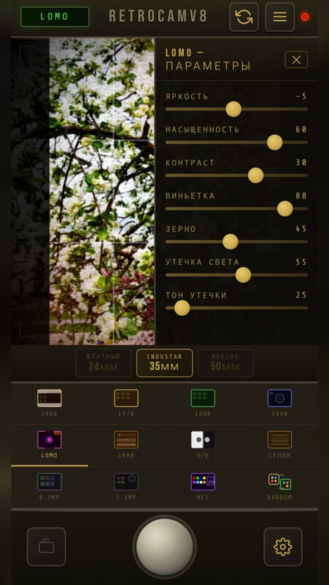
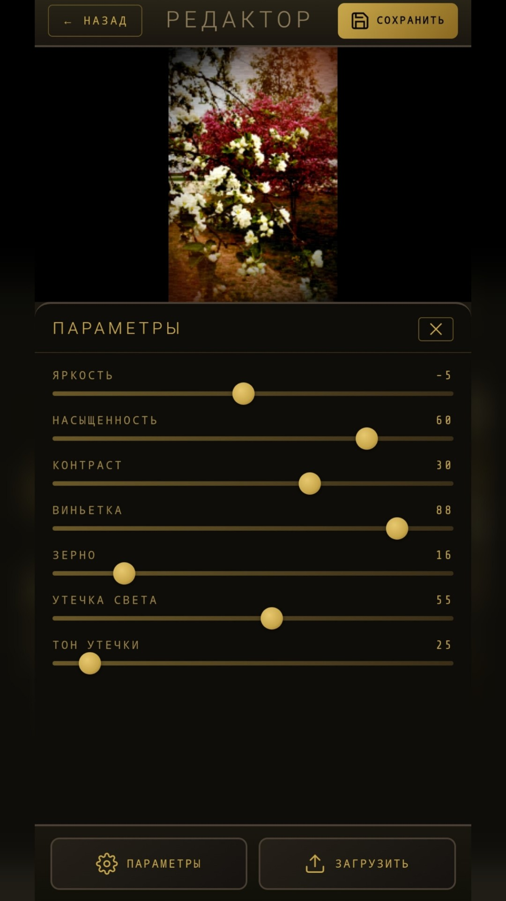
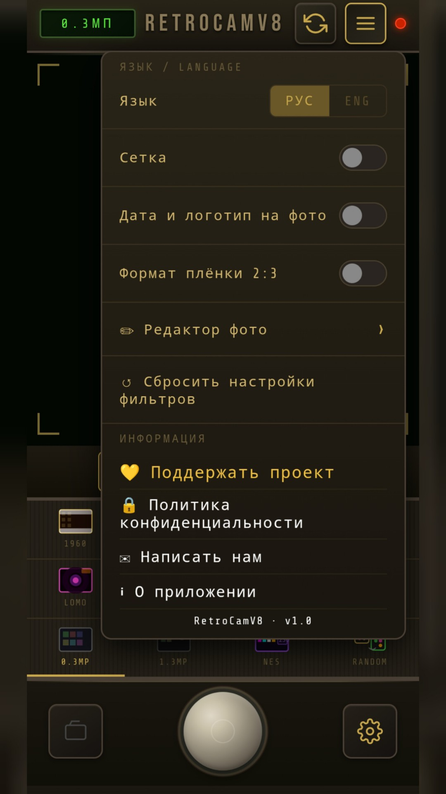
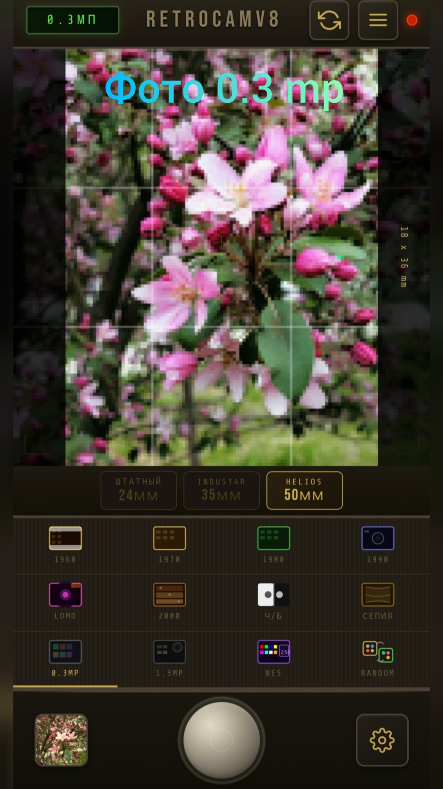

# 📸 RetroCamV8

**RetroCamV8** — профессиональное приложение для создания атмосферных фотографий в стиле ретро и винтаж. Сочетает камеру с реалистичными плёночными фильтрами и мощный фоторедактор.
*(Professional application for creating atmospheric photos in retro and vintage style.)*

## ✨ Особенности / Key Features

**📷 Режимы съёмки:**
- Выбор из трёх объективов: штатный 24мм, Industar 35мм, Helios 50мм
- Аутентичное разрешение 0.3 МП для эффекта старых камер
- Сетка для композиции кадра (правило третей)
- Возможность добавления даты и логотипа на фото

**🎨 Фильтры и эффекты:**
- 12+ тематических фильтров по десятилетиям (1960-2000 годы)
- Специальные режимы: LOMO, Ч/Б, Сепия, NES, Random
- Эффект плёночного формата 2:3
- Реалистичная эмуляция винтажных камер

**🔧 Профессиональный редактор:**
- Тонкая настройка всех параметров:
  - Яркость и насыщенность
  - Контраст и виньетка
  - Зернистость плёнки
  - Утечка света (light leaks) с настройкой тона
- Сохранение отредактированных фотографий

**🌐 Интерфейс:**
- Двуязычный интерфейс (Русский / English)
- Интуитивное управление
- Тёмная тема в ретро-стиле

---

## 🇬🇧 First Stable Release of RetroCamV8!

We're excited to present the first version of our application for creating atmospheric retro photos!

### ✨ What's Included:

**📷 Shooting Modes:**
- Choice of three lenses: Standard 24mm, Industar 35mm, Helios 50mm
- Authentic 0.3 MP resolution for vintage camera effect
- Grid for frame composition (rule of thirds)
- Option to add date and logo to photos

**🎨 Filters and Effects:**
- 12+ thematic filters by decade (1960-2000)
- Special modes: LOMO, B&W, Sepia, NES, Random
- 2:3 film format effect
- Realistic vintage camera emulation

**🔧 Professional Editor:**
- Fine-tuning of all parameters:
  - Brightness and saturation
  - Contrast and vignette
  - Film grain
  - Light leaks with tone adjustment
- Save edited photos

**🌐 Interface:**
- Bilingual interface (Russian / English)
- Intuitive controls
- Dark retro-styled theme

---

## 🖼️ Скриншоты / Screenshots

<table>
<tr>
<td></td>
<td></td>
<td></td>
<td></td>
<td></td>
</tr>
</table>

---

## 📥 Скачать / Download

### APK (Android)
📥 **[Скачать последнюю версию (v1.0.0)](https://github.com/Paminabea/retrocamera-app/releases/download/v1.0.0/RetroCamera.apk)**

### Магазины приложений / App Stores
- [RuStore]() *(вставь ссылку)*
- [Huawei AppGallery]() *(вставь ссылку)*

---

## 🛠️ Технологии / Tech Stack
HTML5 Canvas • JavaScript • CSS3 • Capacitor/Cordova (для сборки APK)

---

## 👨‍💻 Автор / Author
**Сергей (Paminabea)**  
GitHub: [@Paminabea](https://github.com/Paminabea) | Email: paminabea@gmail.com
